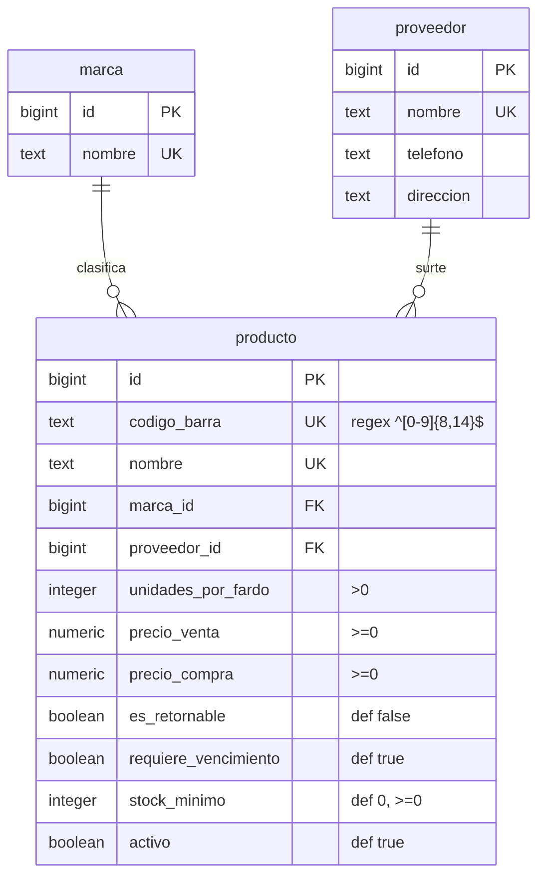
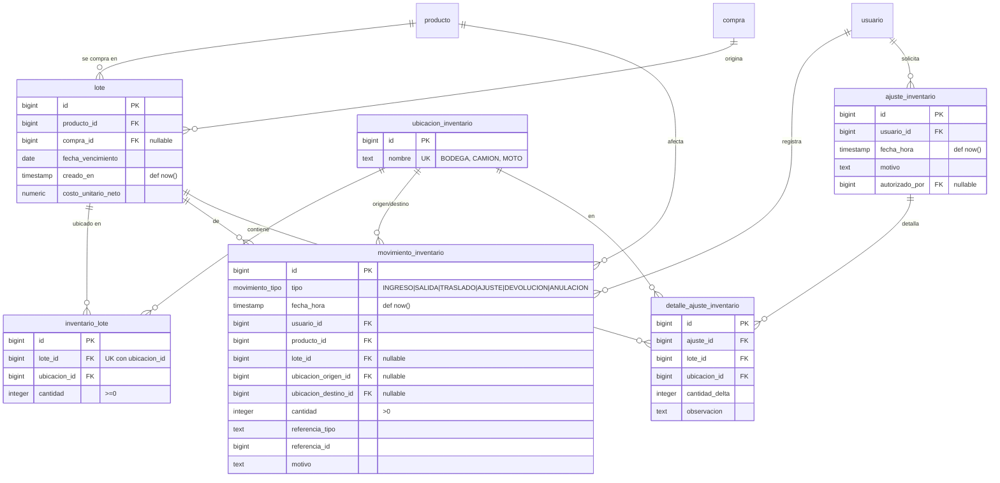
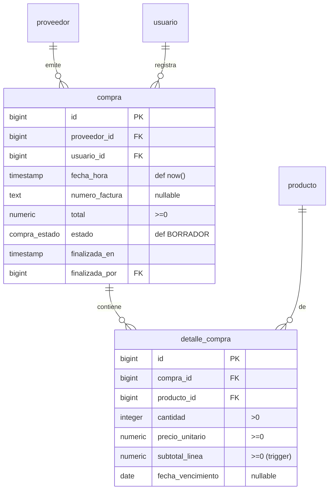
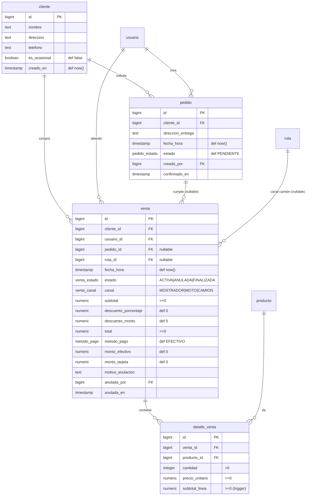
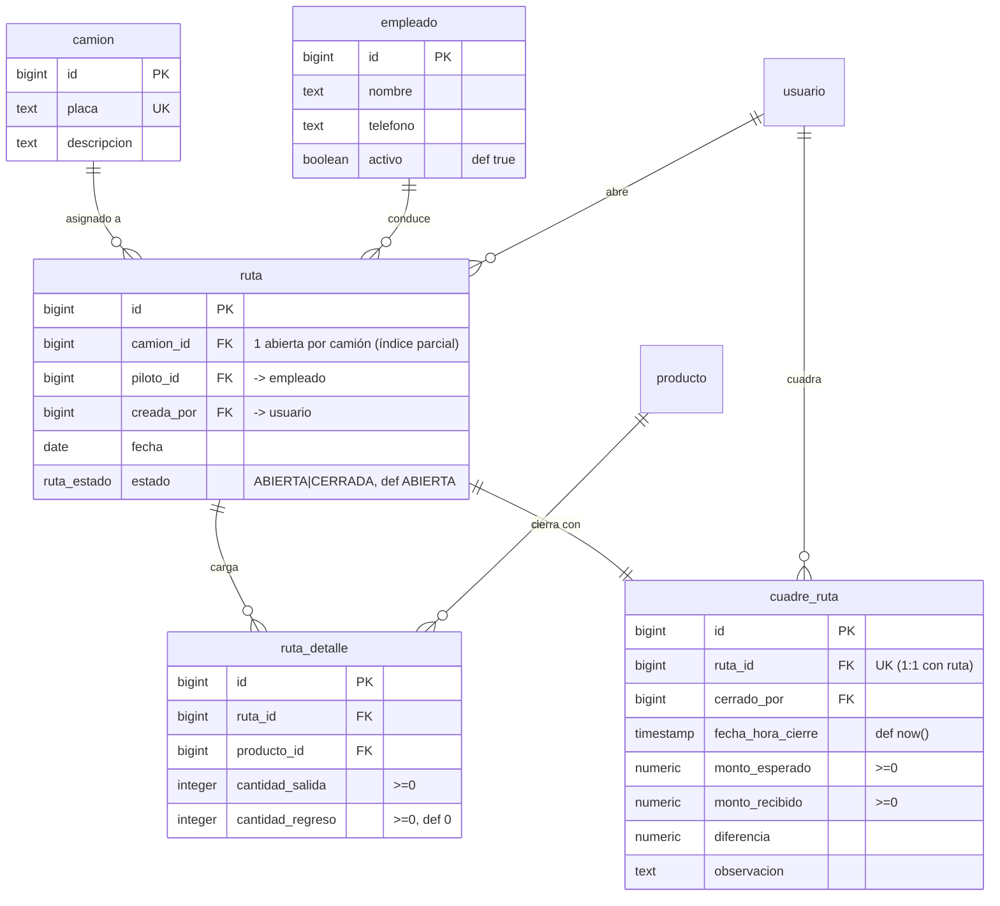
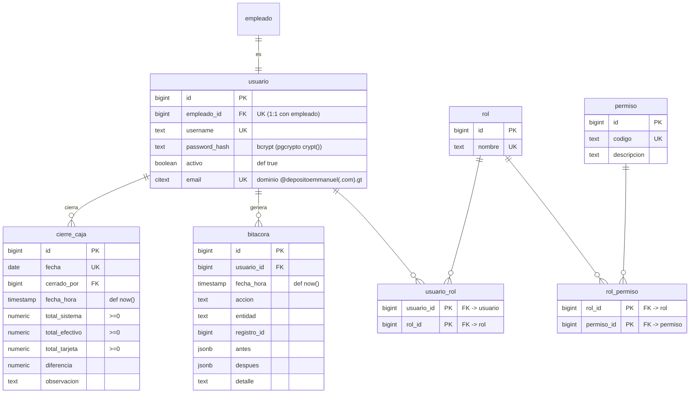

# Modelo Entidad–Relación — Depósito Emmanuel

Base de datos **PostgreSQL 18**. Esquema `public`. Sistema de gestión para un
depósito de bebidas: catálogo, inventario por lote y ubicación, compras, ventas
de mostrador, distribución en camión y control de accesos.

> Este documento describe el esquema **tal como está** (restaurado y depurado el
> 2026-08-28 desde el respaldo limpio del 24-ago). Los diagramas están agrupados
> por dominio para lectura; al final hay una lista de mejoras sugeridas.

---

## 1. Dominios

| Dominio | Tablas |
|---|---|
| **Catálogo** | `marca`, `proveedor`, `producto` |
| **Inventario** | `ubicacion_inventario`, `lote`, `inventario_lote`, `movimiento_inventario`, `ajuste_inventario`, `detalle_ajuste_inventario` |
| **Compras** | `compra`, `detalle_compra` |
| **Ventas** | `cliente`, `venta`, `detalle_venta`, `pedido` |
| **Distribución** | `camion`, `empleado`, `ruta`, `ruta_detalle`, `cuadre_ruta` |
| **Seguridad y caja** | `usuario`, `rol`, `permiso`, `usuario_rol`, `rol_permiso`, `bitacora`, `cierre_caja` |

Todas las claves primarias son `bigint … GENERATED ALWAYS AS IDENTITY`.
`PK` = clave primaria · `FK` = foránea · `UK` = única.

---

## 2. Catálogo

---

## 3. Inventario

El stock **no** vive en `producto`: se calcula sumando `inventario_lote.cantidad`
para el producto en una ubicación. `movimiento_inventario` es la bitácora física
(todo ingreso, salida o traslado deja un renglón).

---

## 4. Compras

Flujo: se crea `compra` en `BORRADOR` con sus `detalle_compra`, luego la función
`finalizar_compra(compra_id, usuario_id)` genera los `lote`, mete stock en
`inventario_lote` (BODEGA) y registra `movimiento_inventario` de tipo `INGRESO`.

---

## 5. Ventas

Venta de mostrador: descuenta stock de BODEGA por FIFO (vencimiento, luego id) y
crea `venta` + `detalle_venta`. `pedido` es una entidad prevista para pedidos a
domicilio (hoy sin uso desde la aplicación).

---

## 6. Distribución

Abrir ruta → cargar camión (BODEGA→CAMION FIFO) → registrar regreso y vendido →
`cuadre_ruta` compara efectivo recibido contra lo que dice el sistema.

---

## 7. Seguridad y caja

`usuario` se asocia 1:1 con un `empleado`. Permisos vía roles (`usuario_rol`,
`rol_permiso`). `bitacora` audita cambios de la aplicación; `cierre_caja` cuadra
la caja diaria.

---

## 8. Tipos enumerados

| ENUM | Valores |
|---|---|
| `compra_estado` | BORRADOR · FINALIZADA · ANULADA |
| `venta_estado` | ACTIVA · ANULADA · FINALIZADA |
| `venta_canal` | MOSTRADOR · MOTO · CAMION |
| `metodo_pago` | EFECTIVO · TARJETA · MIXTO |
| `movimiento_tipo` | INGRESO · SALIDA · TRASLADO · AJUSTE · DEVOLUCION · ANULACION |
| `ruta_estado` | ABIERTA · CERRADA |
| `pedido_estado` | PENDIENTE · CONFIRMADO · CANCELADO · ENTREGADO |

Extensiones usadas: `citext` (email sin distinción de mayúsculas), `pgcrypto`
(`crypt()` para contraseñas).

---

## 9. Lógica en la base de datos

### Funciones

| Función | Rol |
|---|---|
| `finalizar_compra(compra_id, usuario_id)` | Pasa una compra de BORRADOR a FINALIZADA: crea lotes, stock en BODEGA y movimientos de INGRESO. |
| `fn_cargar_camion_fifo(ruta_id, usuario_id, items jsonb)` | Traslada producto BODEGA→CAMION por FIFO de vencimiento y acumula `ruta_detalle.cantidad_salida`. |
| `fn_cerrar_ruta_sin_ventas(ruta_id, usuario_id, monto_recibido, obs)` | Devuelve lo no vendido CAMION→BODEGA, consume lo vendido y crea `cuadre_ruta`. |

### Triggers

| Trigger | Tabla | Efecto |
|---|---|---|
| `trg_subtotal_detalle_compra` | `detalle_compra` | `subtotal_linea = cantidad * precio_unitario` (BEFORE INS/UPD). |
| `trg_subtotal_detalle_venta` | `detalle_venta` | Igual para ventas. |
| `trg_validar_vencimiento_lote` | `lote` | Exige/prohíbe `fecha_vencimiento` según `producto.requiere_vencimiento`. |
| `trg_bloquear_update_detalle_compra` | `detalle_compra` | Impide modificar/borrar renglones de una compra FINALIZADA. |
| `trg_no_update_cliente_id` | `cliente` | Impide cambiar el `id`. |

### Vistas

| Vista | Contenido |
|---|---|
| `vw_stock_producto_ubicacion` | `(producto_id, ubicacion_id, stock)` — suma de existencias. |
| `vw_stock_por_ubicacion` | Lo anterior con nombres y todas las combinaciones producto×ubicación (solo productos activos). |
| `vw_seguimiento_ruta` | Detalle de ruta con camión, piloto, producto y `vendido_estimado`. |

---

## 10. Mejoras sugeridas (opcionales)

Ninguna es urgente; el esquema funciona. En orden de valor:

1. **`inventario_lote.cantidad` con índice único ya cubierto** — bien. Falta un
   índice en `movimiento_inventario(referencia_tipo, referencia_id)` para
   rastrear rápido "todos los movimientos de la venta X" (hoy sí existe
   `idx_mov_ref`, ✔).
2. **`compra.numero_factura`**: es `nullable` y sin unicidad. Si el negocio no
   permite dos compras con la misma factura del mismo proveedor, añadir
   `UNIQUE (proveedor_id, numero_factura)`.
3. **`cliente.telefono` / `proveedor.telefono`**: sin formato. Un `CHECK` de
   patrón (o dejar libre a propósito) evita datos sucios.
4. **Nombres**: casi todo es consistente (`snake_case`, español). Las únicas
   asimetrías son `cuadre_ruta.fecha_hora_cierre` vs. `compra.fecha_hora` /
   `venta.fecha_hora` — unificar a `fecha_hora` daría uniformidad total.
5. **Tablas previstas y sin uso desde la app**: `pedido`, `ajuste_inventario` +
   `detalle_ajuste_inventario`, `cierre_caja`, `bitacora`. Están bien diseñadas
   y son parte del alcance del negocio (pedidos a domicilio, ajustes de
   inventario, cierre de caja, auditoría). **Recomendación: conservarlas** e
   irlas conectando; no aportan riesgo vacías.
6. **`movimiento_inventario.referencia_tipo`** es texto libre (`'COMPRA'`,
   `'RUTA_CARGA'`, `'VENTA'`, …). Convertirlo en ENUM documentaría los valores
   válidos.
7. **Auditoría automática**: `bitacora` hoy se llenaría desde la aplicación.
   Un trigger genérico `AFTER INSERT/UPDATE/DELETE` sobre las tablas clave la
   poblaría sin depender del backend.

---

*Generado el 2026-08-28 a partir del esquema en `DepositoEmmanuel`.*
